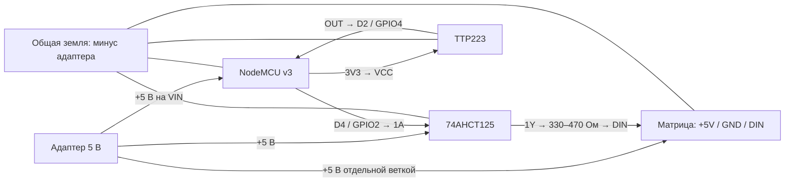

# Сборка лампы и распайка

Базовый вариант: NodeMCU v3 ESP8266, гибкая или жёсткая RGB-матрица WS2812B 16×16,
сенсор TTP223. Подключение соответствует настройкам готового бинарника.

## Компоненты на одну лампу

| Компонент | Количество | Что выбирать |
| --- | --- | --- |
| NodeMCU v3 | 1 | ESP8266 / ESP-12E или ESP-12F, flash 4 МБ; USB-переходник CH340G |
| Адресная матрица | 1 | **WS2812B, 16×16, 256 RGB-пикселей, 5 В**, GRB, разводка змейкой |
| Сенсорная кнопка | 1 | TTP223, моментальный режим, активный HIGH, питание от 3,3 В |
| Блок питания | 1 | Готовый изолированный адаптер **5 В / 5 А** для сборки с программным лимитом 2 А |
| Преобразователь уровня | 1 | **74AHCT125** или готовый модуль на нём, питание 5 В |
| Резистор в DATA | 1 | 330–470 Ом, 0,125–0,25 Вт |
| Электролитический конденсатор | 1 | 1000 мкФ, 10 В или выше, с соблюдением полярности |
| Керамический конденсатор | 1 | 100 нФ около питания 74AHCT125 |
| Разъём питания, выключатель, провода | Комплект | Контакты и сечение под ток вашей сборки |
| Корпус, основание и рассеиватель | Комплект | Изолирующий каркас для матрицы, матовый плафон, место для электроники |
| USB-кабель | 1 | Кабель с передачей данных, под разъём конкретной NodeMCU |

Блок 5 В / 5 А выбран с запасом для текущего лимита матрицы 2 А и питания платы.
Этот вариант рассчитан на ограниченную яркость. Если снять лимит, заранее
пересчитайте питание и проводку: оценка для старых пикселей до 60 мА на полном
белом даёт **256 × 0,06 = 15,36 А** только на матрицу; реальные ревизии различаются.

Программный лимит — оценка FastLED, а не аппаратный ограничитель или защита от
короткого замыкания. Используйте защищённый адаптер и изолированные соединения;
номинал предохранителя подбирайте по реальному току, разъёму и проводам.
Сетевую часть 230 В внутрь самодельной лампы не размещайте: используйте готовый
внешний адаптер с низковольтным выходом.

## Общая схема

Схема показывает соединения, а не физическое расположение выводов на платах.
Обозначение **D4 — это GPIO2**, а **D2 — GPIO4**. Не путайте номер D с номером GPIO.

## Что к чему паять

Питание отключено на всём этапе пайки. Ориентируйтесь на подписи контактов,
а не на цвет провода или порядок контактов разъёма.

| Откуда | Куда | Примечание |
| --- | --- | --- |
| Адаптер `+5 В` | Матрица `+5V` | Отдельный силовой провод, без пропускания тока через NodeMCU |
| Адаптер `GND / −` | Матрица `GND` | Силовая земля |
| Адаптер `+5 В` | NodeMCU `VIN` | Только если конкретная плата допускает питание этого входа от 5 В |
| Адаптер `GND / −` | NodeMCU `G / GND` | Общая земля обязательна |
| NodeMCU `D4 / GPIO2` | Вход `1A` 74AHCT125 | Сигнал 3,3 В |
| Выход `1Y` 74AHCT125 | Резистор → матрица `DIN` | Резистор около входа матрицы; подключать к **DIN**, не DOUT |
| NodeMCU `3V3` | TTP223 `VCC` | Сенсор питается от 3,3 В |
| NodeMCU `GND` | TTP223 `GND` | Общая земля |
| TTP223 `OUT / I/O / SIG` | NodeMCU `D2 / GPIO4` | У обычного TTP223 высокий уровень при касании |
| Конденсатор 1000 мкФ `+` | Матрица `+5V` | Рядом с вводом питания матрицы |
| Конденсатор 1000 мкФ `−` | Матрица `GND` | Полоса на электролите обычно обозначает минус |

Провод DATA держите коротким и прокладывайте рядом с землёй. Для силовой части
не используйте тонкие макетные перемычки Dupont. Сечение выбирайте по длине,
току и допустимой просадке; питание большой матрицы при необходимости подводится
в нескольких предусмотренных производителем точках от **одного** адаптера.

### Распайка 74AHCT125

Для 14-выводного корпуса PDIP/SOIC, нумерация по виду сверху из datasheet:

| Вывод | Сигнал | Соединение |
| --- | --- | --- |
| 14 | VCC | +5 В |
| 7 | GND | Общая земля |
| 1 | `/1OE` | GND, включить первый канал |
| 2 | `1A` | D4 NodeMCU |
| 3 | `1Y` | Через 330–470 Ом на DIN матрицы |
| 4, 10, 13 | Неиспользуемые `/OE` | +5 В, выключить каналы |
| 5, 9, 12 | Неиспользуемые входы A | GND |
| 6, 8, 11 | Неиспользуемые выходы Y | Оставить неподключёнными |

Между выводами 14 и 7 поставьте 100 нФ рядом с микросхемой.
Для другого корпуса сверяйте его распиновку; у готового модуля используйте подписи.
Не заменяйте AHCT на произвольный преобразователь для I²C: это другая задача.
Прямое соединение D4 с DIN иногда работает, но уровень 3,3 В не гарантирует
стабильную работу матрицы с питанием 5 В.

### NodeMCU: питание и USB

Не подавайте 5 В на вывод **3V3**, D2 или D4. Выводы **VIN**, **VU** и **3V3**
на клонах имеют разное назначение: сверяйтесь с маркировкой и схемой своей платы.
Приведённая схема использует 5 В на VIN совместимой NodeMCU, а не на VU.

Матрица не должна питаться через USB-разъём компьютера или плату NodeMCU.
Прошить плату удобнее до окончательной сборки. Для дальнейшей прошивки
отсоедините внешнее питание и отключите силовую часть матрицы и DATA от платы,
затем подключайте USB. Одновременное питание USB и VIN допустимо только при
проверенной развязке конкретной платы; в инструкции оно не требуется.

### Настройка сенсора

TTP223 должен выдавать сигнал, пока палец касается площадки, и отпускать его после
убирания пальца. Режим фиксации toggle не подходит для двойных касаний и удержания.
Обозначения перемычек на модулях различаются: используйте описание своего модуля.
По умолчанию прошивка ожидает **D2, активный HIGH**. Если сенсора нет, вход не стоит
оставлять плавающим: отключите его через API, как описано в [разработке](DEVELOPMENT.md).

## Порядок сборки

1. Проверьте маркировку матрицы, напряжение 5 В и направление стрелок DATA.
2. Соберите и прошейте NodeMCU отдельно по [инструкции](FLASHING.md).
3. Подготовьте основание и изолированный каркас; примерьте матрицу и плафон.
4. При цилиндрической сборке разместите нижнюю строку матрицы у основания.
   Не перегибайте матрицу по светодиодам и пайкам, не допускайте контакта её
   обратной стороны с металлом. Размер корпуса выбирается под реальную матрицу.
5. На отключённом питании спаяйте общую землю, затем питание, преобразователь,
   DATA и сенсор. Изолируйте соединения и закрепите провод питания от вырывания.
6. Мультиметром проверьте отсутствие короткого замыкания +5V–GND, полярность,
   а затем напряжение адаптера до подключения к электронике.
7. Подайте питание, настройте Wi-Fi и начните с небольшой яркости. Проверьте
   равномерность света и отсутствие нагрева разъёмов и проводов перед закрытием корпуса.
8. Установите матовый рассеиватель. Плотность, расстояние до матрицы и форма
   плафона заметно влияют на вид эффекта; готовой модели корпуса в репозитории нет.

## Ориентация матрицы и ток

В [include/config.h](../include/config.h) находятся настройки, применяемые при сборке:

| Параметр | По умолчанию | Назначение |
| --- | --- | --- |
| `LED_PIN` | 2 | GPIO2, физическая подпись D4 |
| `MATRIX_WIDTH`, `MATRIX_HEIGHT` | 16, 16 | Размеры матрицы |
| `SERPENTINE` | true | Змейка |
| `VERTICAL_WIRING` | false | Строки; true — столбцы |
| `FLIP_X`, `FLIP_Y` | false | Зеркало и переворот |
| `MAX_MILLIAMPS` | 2000 | Расчётный лимит тока светодиодов FastLED |

Первый пиксель по умолчанию находится снизу слева. Если огонь идёт боком,
проверьте `VERTICAL_WIRING`; если вверх ногами — `FLIP_Y`; для зеркала — `FLIP_X`.
После изменения конфига пересоберите и загрузите прошивку.

## Источники по электрическому подключению

- [Adafruit: питание NeoPixel](https://learn.adafruit.com/adafruit-neopixel-uberguide/powering-neopixels) — питание и оценка потребления.
- [Adafruit: рекомендации по монтажу](https://learn.adafruit.com/adafruit-neopixel-uberguide/best-practices) — резистор, конденсатор и уровни.
- [TI: SN74AHCT125](https://www.ti.com/lit/ds/symlink/sn74ahct125.pdf) — выводы, питание и логические уровни.
